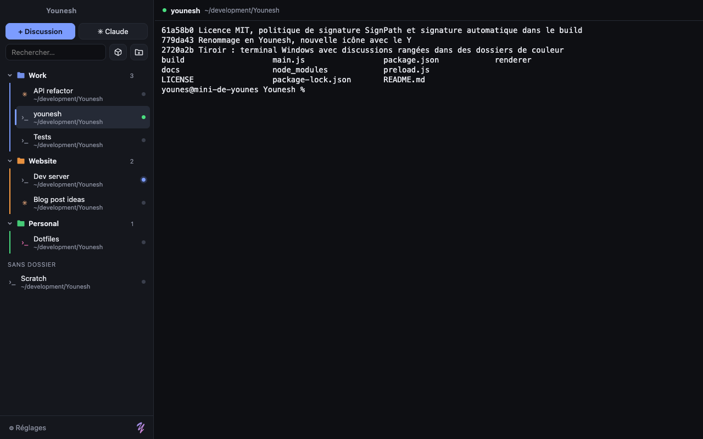

<p align="center"></p>

<p align="center"><a href="README.md">English</a> · <b>Français</b></p>

# Younesh

Un terminal pour Windows où chaque discussion est rangée à gauche, dans des dossiers de couleur.



## Installer sur Windows

1. Ouvre la page **Releases** du dépôt et télécharge :
   - `Younesh-Setup-x.y.z.exe` pour l'installer (raccourci dans le menu Démarrer). Ensuite, Younesh se met à jour tout seul : la nouvelle version se télécharge en arrière-plan et s'installe quand tu le fermes (case à décocher dans Réglages) ;
   - ou `Younesh-x.y.z.msi`, le même en .msi, pratique pour une installation par la DSI ou en silence (`msiexec /i Younesh-x.y.z.msi /qn`). Pas de mise à jour automatique avec lui : Younesh signale les nouvelles versions ;
   - ou `Younesh-Portable-x.y.z.exe` pour le lancer sans installation. Celui-là ne se met pas à jour, il te signale juste qu'une nouvelle version est sortie.
2. L'app n'est pas signée, donc Windows affiche « Windows a protégé votre ordinateur ». Clique sur **Informations complémentaires**, puis **Exécuter quand même**.

## Ce que ça fait

- **Discussions à gauche** : chaque terminal est une discussion avec un nom, un dossier de travail et un shell (PowerShell 7, Windows PowerShell, Invite de commandes, Git Bash ou WSL, détectés automatiquement).
- **Dossiers de couleur** : crée des dossiers, choisis leur couleur (palette ou couleur libre), replie-les, renomme-les avec un double-clic. Une discussion peut aussi avoir sa propre couleur. Un dossier coloré teinte en pâle tout ce qu'il contient.
- **Glisser-déposer** : range une discussion dans un dossier, change l'ordre des discussions ou des dossiers.
- **Discussions Claude Code** : le bouton ✳ Claude lance `claude` dans le dossier choisi. Chaque discussion garde sa propre conversation, qui reprend là où tu t'étais arrêté, même après avoir fermé Younesh.
- **Claude t'attend** : quand Claude a fini et attend ta réponse, la discussion passe en orange et l'icône clignote dans la barre des tâches (la notification Windows s'active dans les Réglages). Ça marche aussi avec la sonnerie du terminal et les notifications OSC 9/777/99 de n'importe quel programme.
- **Branche git** sous le nom de chaque discussion, lue directement dans `.git` (sans lancer git). Le chemin du dossier est dans la barre du haut.
- **Terminal rapide** : le bouton ›_ ouvre tout de suite un terminal dans ton dossier personnel (`C:\Users\toi`) avec le shell par défaut.
- **Nom donné par Claude** : `/rename` dans Claude Code renomme la discussion.
- **Recherche dans le terminal** avec surlignage, et **sélecteur rapide** pour aller à n'importe quelle discussion ou action en quelques lettres.
- **Rapide** : rendu par la carte graphique (WebGL), historique réglable.
- **Sandbox sbx** : le bouton ⧉ crée une sandbox pour un projet en quelques clics : tu choisis le dossier, tu coches ce qu'il faut installer dedans (plugins, paquets système…), c'est prêt. La configuration est en trois couches, pour qu'une nouvelle version de sbx ne touche que les commandes sbx :
  - `cli` : les commandes sbx elles-mêmes (créer, ouvrir, exécuter, supprimer) ;
  - `setup` : la préparation du poste, une fois par PC (connexion, règles réseau, secrets), sous forme de liste à cocher ;
  - `installs` : ce qu'on peut installer dans une sandbox, choisi projet par projet et envoyé en un seul `exec`.

  Le bouton ⧉ sert aussi à **ouvrir une sandbox existante** : Younesh liste celles du PC (`sbx ls`), même créées dans un autre terminal, et la rouvre dans une discussion.
  La configuration reste sur le PC et s'importe ou s'exporte en JSON (clic droit sur ⧉, Configurer sbx). Variables : `{projet}`, `{dossier}`, `{script}`, et `{secret:NOM}`, demandé au lancement et jamais enregistré.
- **SSH et tunnels** (à activer dans les Réglages) : le bouton serveur ajoute des connexions SSH dans la barre latérale, comme n'importe quelle discussion, ou les importe depuis `~/.ssh/config`. Younesh lance le client OpenSSH livré avec Windows : les clés, l'agent SSH et `known_hosts` marchent comme d'habitude. Les **tunnels** (redirection de ports) tournent en arrière-plan, chacun avec son interrupteur : local (`-L`, la base de données d'un serveur sur `localhost`), distant (`-R`) ou proxy SOCKS (`-D`). Quand ssh demande un mot de passe, une phrase de passe ou de confirmer un nouveau serveur, Younesh pose la question dans une petite fenêtre. Un tunnel qui coupe se relance tout seul, et un tunnel peut s'ouvrir au démarrage de Younesh. Aucun mot de passe n'est enregistré.
- **Commande au démarrage** : par exemple `npm run dev` pour un serveur qui se relance d'un clic.
- **Tout lancer** : ▶ sur un dossier démarre toutes ses discussions (serveur, Claude, tests…) d'un coup ; « Tout arrêter » les coupe.
- **Côte à côte** : deux discussions l'une à côté de l'autre, avec un séparateur déplaçable.
- **Glisser un fichier** dans le terminal pour coller son chemin, avec les guillemets qu'il faut.
- **Contenu retrouvé** : les 1000 dernières lignes de chaque terminal reviennent après un redémarrage.
- **Thèmes** : Sombre, Minuit, Graphite, Clair ou automatique, style du curseur, barre latérale translucide (effet Mica de Windows 11, expérimental).
- **Sauvegarde** : exporte et importe tes dossiers, discussions et réglages pour passer d'un PC à l'autre.
- **Pastilles** : vert = en cours, bleu = nouvelle activité, rouge = terminé, gris = en veille (démarre au clic).
- Tout est sauvegardé : dossiers, couleurs, ordre et taille de la fenêtre.

## Raccourcis

| Action | Touches |
| --- | --- |
| Sélecteur rapide (discussions et actions) | Ctrl+Maj+P |
| Nouvelle discussion | Ctrl+Maj+T |
| Nouvelle discussion Claude | Ctrl+Maj+N |
| Terminal dans le dossier personnel | Ctrl+Maj+Q |
| Nouveau dossier | Ctrl+Maj+D |
| Discussion suivante / précédente | Ctrl+Tab / Ctrl+Maj+Tab |
| Fermer la discussion | Ctrl+Maj+W |
| Renommer | F2 |
| Chercher dans le terminal | Ctrl+Maj+F |
| Aller à la discussion qui attend | Ctrl+Maj+U |
| Côte à côte / un seul panneau | Ctrl+Maj+E |
| Masquer la barre latérale | Ctrl+Maj+B |
| Taille du texte | Ctrl + / Ctrl − / Ctrl 0 |
| Copier / coller | Ctrl+C (avec une sélection) ou Ctrl+Maj+C / Ctrl+V |
| Retour à la ligne dans Claude (même lancé à la main dans un shell) | Maj+Entrée |

Clic droit sur une discussion ou un dossier pour toutes les options. Clic molette sur une discussion pour la fermer.

## Développer

```bash
npm install
npm start          # lance l'app
npm run dist       # fabrique les .exe (sur Windows)
```

Les `.exe` sont fabriqués automatiquement par GitHub Actions à chaque tag `v*` (par exemple `git tag v1.0.1 && git push --tags`).

Electron, xterm.js et node-pty.

## Signature et confidentialité

Voir la [version anglaise](README.md#code-signing-policy) : signature gratuite par SignPath Foundation, et aucune donnée envoyée sur internet.

## Licence

[MIT](LICENSE)

---

<p align="right"><em>Fait par Y</em></p>
