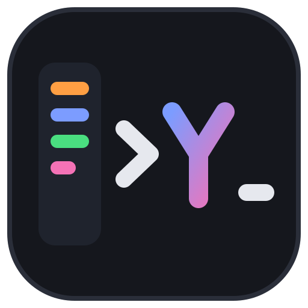
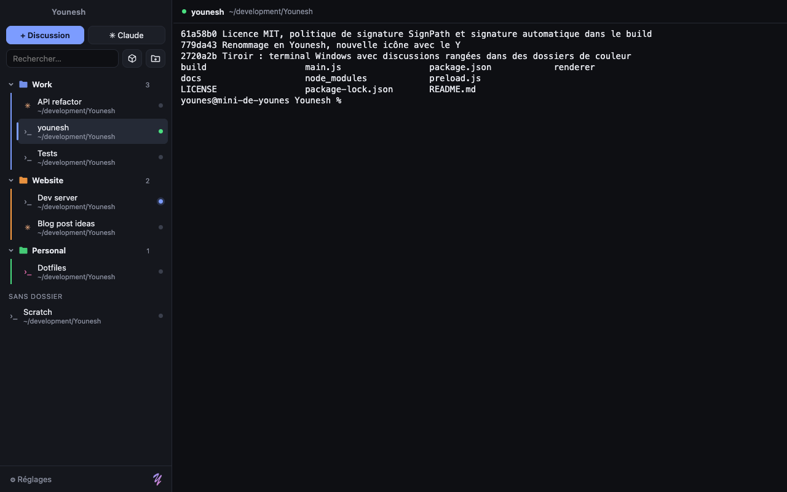

<p align="center"></p>

<p align="center"><b>English</b> · <a href="README.fr.md">Français</a></p>

# Younesh

A free, open-source terminal for Windows that keeps every session in a sidebar, organized in colored folders. No account, no subscription, no telemetry.



## Install

Download from the [Releases](https://github.com/jonasmelheb/younesh/releases) page:

- `Younesh-Setup-x.y.z.exe` installs Younesh for the current user (no admin rights needed, Start menu shortcut).
- `Younesh-Portable-x.y.z.exe` runs without installing.

## Features

- **Sessions in a sidebar**: each terminal session has a name, a working directory and a shell. PowerShell 7, Windows PowerShell, Command Prompt, Git Bash and WSL are detected automatically.
- **Colored folders**: create folders, pick a color (palette or custom), collapse them, rename them with a double-click. A session can have its own color too.
- **Drag and drop**: move sessions between folders and reorder sessions and folders.
- **Claude Code sessions**: the ✳ Claude button starts `claude` in the chosen directory. Each session keeps its own conversation and resumes it after Younesh is closed.
- **Claude is waiting**: when Claude stops working and waits for your answer, the session turns orange, Windows shows a notification and the taskbar icon flashes. The terminal bell and OSC 9/777/99 notifications work too, for any program.
- **Git branch** of each session in the sidebar, read straight from `.git` (no git process).
- **Find in terminal** with highlighted matches, and a **quick switcher** to jump to any session or action in a few keystrokes.
- **Fast**: GPU rendering (WebGL), configurable scrollback.
- **Sandbox sessions**: the ⧉ button opens a session in a sandbox. Right-click it to set the command (`{dossier}` is replaced by the working directory).
- **Startup command**: e.g. `npm run dev`, restarted in one click.
- **Status dots**: green = running, blue = new output, red = exited, grey = idle (starts on click).
- Everything is saved locally: folders, colors, order and window size.

## Keyboard shortcuts

| Action | Keys |
| --- | --- |
| Quick switcher (sessions and actions) | Ctrl+Shift+P |
| New session | Ctrl+Shift+T |
| New Claude session | Ctrl+Shift+N |
| New folder | Ctrl+Shift+D |
| Next / previous session | Ctrl+Tab / Ctrl+Shift+Tab |
| Close session | Ctrl+Shift+W |
| Rename | F2 |
| Find in terminal | Ctrl+Shift+F |
| Jump to the session waiting for you | Ctrl+Shift+U |
| Toggle sidebar | Ctrl+Shift+B |
| Font size | Ctrl + / Ctrl − / Ctrl 0 |
| Copy / paste | Ctrl+C (with a selection) or Ctrl+Shift+C / Ctrl+V |
| New line in Claude | Shift+Enter |

Right-click a session or a folder for all options. Middle-click a session to close it.

## Development

```bash
npm install
npm start          # run the app
npm run dist       # build the Windows .exe files (on Windows)
```

Releases are built from source by GitHub Actions for every `v*` tag ([workflow](.github/workflows/build.yml)).

Built with Electron, xterm.js and node-pty.

## Code signing policy

Free code signing provided by [SignPath.io](https://about.signpath.io), certificate by [SignPath Foundation](https://signpath.org).

- Committers and reviewers: [jonasmelheb](https://github.com/jonasmelheb)
- Approvers: [jonasmelheb](https://github.com/jonasmelheb)

Every release is built from this repository by GitHub Actions; only those builds are signed.

## Privacy policy

This program will not transfer any information to other networked systems unless specifically requested by the user or the person installing or operating it. Everything Younesh saves (folders, colors, sessions, settings) stays in a local file on the computer (`%APPDATA%\younesh`).

## License

[MIT](LICENSE)

---

<p align="right"><em>Made by Y</em></p>
